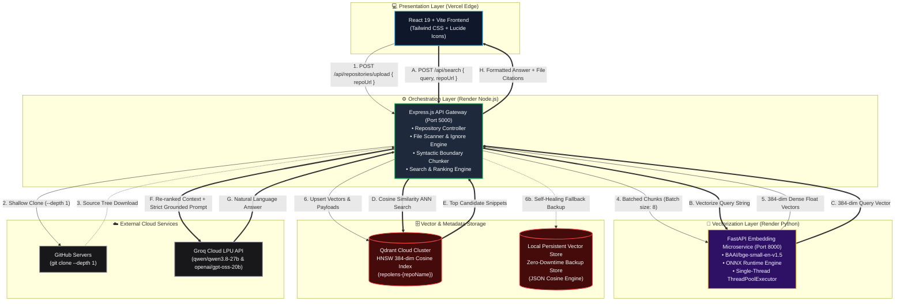
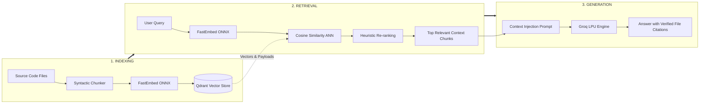
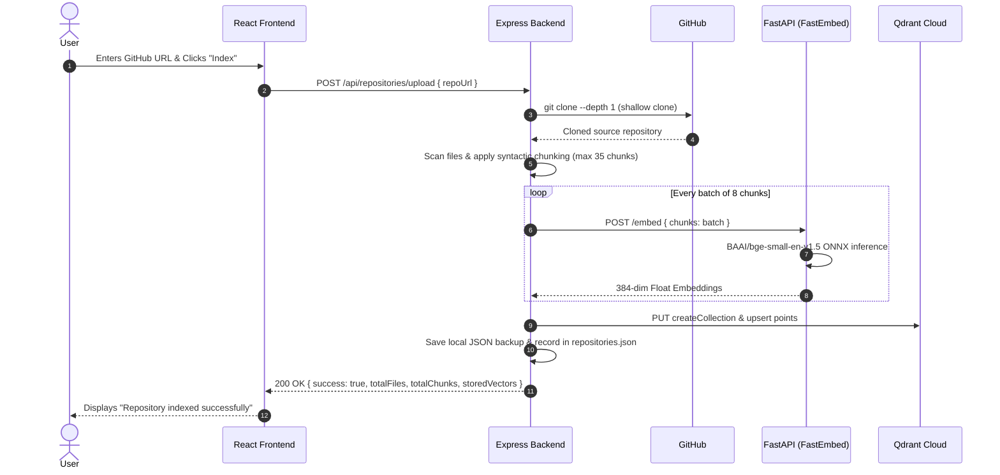
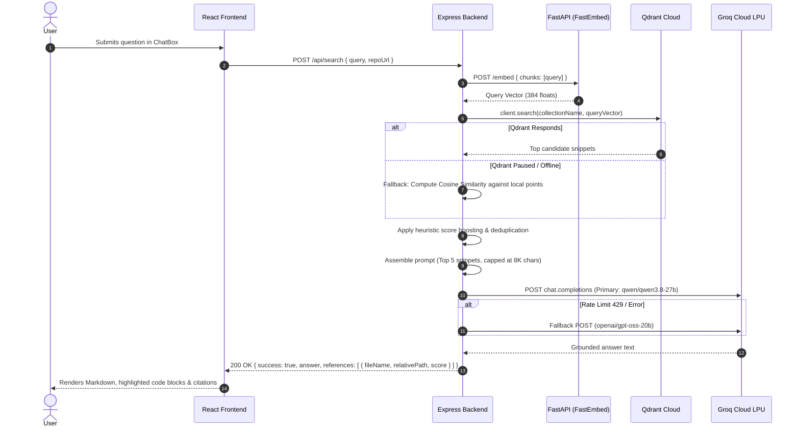
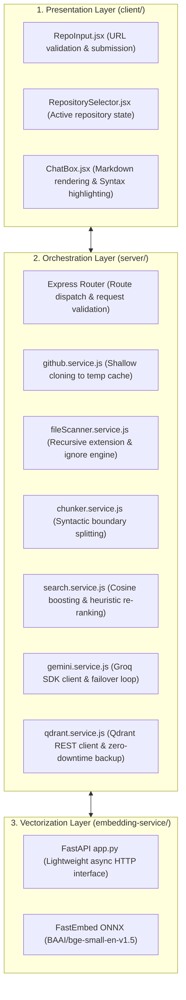

<div align="center">

# ⚡ SourceQuery

### Architectural AI Codebase Intelligence & Semantic Search Engine

Ask complex architectural and implementation questions about any public GitHub repository in natural language.<br>
Get context-grounded answers with verifiable file-level citations, powered by syntactic code chunking, FastEmbed ONNX vector embeddings, Qdrant vector storage (with zero-downtime fallback), and Groq high-speed LPUs.

<br>

[](https://source-query-swart.vercel.app/)
[](https://sourcequery-api.onrender.com)
[](https://sourcequery-embedding.onrender.com)
[](https://qdrant.tech/)
[](https://groq.com/)
[](LICENSE)

<br>

[](https://react.dev/)
[](https://vitejs.dev/)
[](https://tailwindcss.com/)
[](https://nodejs.org/)
[](https://fastapi.tiangolo.com/)
[](https://github.com/qdrant/fastembed)

</div>

---

## 📑 Table of Contents

- [The Problem \& Vision](#-the-problem--vision)
- [System Architecture](#-system-architecture)
- [Repository Ingestion Pipeline](#-repository-ingestion-pipeline)
- [Query Processing \& RAG Pipeline](#-query-processing--rag-pipeline)
- [Detailed RAG Architecture](#-detailed-rag-architecture)
- [Service-to-Service Communication](#-service-to-service-communication)
- [Internal Data Flow \& Representations](#-internal-data-flow--representations)
- [Component Responsibilities](#-component-responsibilities)
- [Technical Stack](#-technical-stack)
- [Repository Structure](#-repository-structure)
- [Local Development Setup](#-local-development-setup)
- [Environment Variables](#-environment-variables)
- [REST API Reference](#-rest-api-reference)
- [Key Engineering Decisions](#-key-engineering-decisions)
- [Future Roadmap](#-future-roadmap)
- [License \& Author](#-license--author)

---

## 💡 The Problem & Vision

### The Problem: Legacy Code & Onboarding Friction
Developers joining new engineering teams or navigating sprawling open-source codebases spend **up to 70% of their time reading code** just to understand where specific logic lives. 
- **Exact-string search (`Ctrl+F` / `grep`) is brittle:** Searching for `"authentication"` completely misses `verifyToken()`, `validateSession()`, or `checkUserRole()`.
- **LLMs lack private repository context:** Off-the-shelf LLMs cannot ingest 50,000 lines of code due to token limits, and without strict context isolation, they hallucinate non-existent APIs and functions.

### The Solution: SourceQuery
SourceQuery functions as an **autonomous codebase oracle**:
1. You supply any public GitHub repository URL.
2. It executes a shallow git clone, applies smart syntactic chunking across 18+ programming languages, vectorizes the semantic meaning using an ONNX embedding microservice, and stores the mathematical vectors.
3. You query the codebase in natural language (e.g., *"How is the payment webhook verified?"*).
4. It performs Cosine Similarity vector search, boosts context using file-importance heuristics, and synthesizes a step-by-step answer via Groq high-speed LPUs complete with exact file citations.

---

## 🏛️ System Architecture

SourceQuery employs a decoupled, asynchronous microservices architecture that isolates compute-heavy mathematical operations (ONNX vectorization) from non-blocking I/O orchestration (cloning, scanning, API routing) and client interaction.



---

## 🔄 Repository Ingestion Pipeline

When a user submits a public GitHub repository URL, the system executes an automated 7-stage extraction and vectorization sequence.

```mermaid
flowchart TD
    Start([User Submits GitHub URL]) --> Validate[Validate URL & Format]
    Validate --> Clone[Execute Shallow Clone<br/><code>git clone --depth 1</code>]
    Clone --> Scan[File Scanner & Filter Engine]
    
    subgraph Scan_Details [" File Filtering "]
        Scan --> FilterExt{Extension Supported?<br/>.js, .ts, .py, .go, .rs, .md}
        FilterExt -- No --> DropFile[Discard File]
        FilterExt -- Yes --> FilterIgnore{Matches Ignored Pattern?<br/>node_modules, dist, .git, lockfiles}
        FilterIgnore -- Yes --> DropFile
        FilterIgnore -- No --> RetainFile[Retain File for Processing]
    end

    RetainFile --> Chunk[Syntactic Chunker<br/>1200 chars / 200 overlap]

    subgraph Chunk_Details [" Syntactic Boundary Detection "]
        Chunk --> Breakpoints["Locate Semantic Breakpoint<br/>class, function, export, async, interface, struct"]
        Breakpoints --> SurrogateGuard["Sanitize UTF-16 Surrogate Pairs<br/>(Protects against sliced emojis)"]
        SurrogateGuard --> ChunkList["Assemble Structured Chunk Objects<br/>(fileName, relativePath, startLine, endLine, content)"]
    end

    ChunkList --> Cap[Cap Chunks to MAX_CHUNKS = 35]
    Cap --> Batch[Partition Chunks into Batches of 8]
    Batch --> Dispatch[Dispatch HTTP POST to /embed<br/>with Retry Backoff & 400ms Delays]
    Dispatch --> ONNX[FastEmbed ONNX Inference<br/>BAAI/bge-small-en-v1.5]
    ONNX --> Vectors[Receive 384-dim Dense Vectors]
    Vectors --> StoreQdrant[Upsert Points to Qdrant Collection<br/>repolens-{repoName}]
    Vectors --> StoreLocal[Persist Local Vector Backup<br/>server/data/vectors/*.json]
    StoreQdrant --> SaveMeta[Record in repositories.json]
    StoreLocal --> SaveMeta
    SaveMeta --> Finish([Return Indexing Summary to Client])
```

### Ingestion Stages in Detail:

1. **Shallow Clone (`github.service.js`):**
   Executes `git.clone(repoUrl, repoPath, ["--depth", "1"])`. By only fetching the tip of the default branch without historical commit objects, network payload is reduced by over **95%**.
2. **Selective File Scanner (`fileScanner.service.js`):**
   Walks the directory tree recursively. Ignores vendor directories (`node_modules`, `dist`, `build`, `.next`, `coverage`) and non-executable metadata files (`package-lock.json`, `yarn.lock`, `LICENSE`, `CHANGELOG.md`). Retains code in **18+ extensions** (`.js`, `.jsx`, `.ts`, `.tsx`, `.py`, `.go`, `.rs`, `.cpp`, `.java`, `.md`, etc.).
3. **Syntactic Code Chunker (`chunker.service.js`):**
   Uses a sliding context window of `1,200 characters` with a `200-character overlap`. Rather than cutting strings arbitrarily, it looks backwards for natural structural boundaries (`\nclass `, `\nfunction `, `\nexport `, `\nasync `, `\ninterface `). It also prevents malformed UTF-16 surrogate pairs caused by slicing multi-byte characters like emojis (`/[\uD800-\uDBFF]$/`).
4. **ONNX Vectorization (`embedding-service/app.py`):**
   Batches of 8 code chunks are sent to the FastAPI microservice. Text is truncated to 500 characters for high-throughput CPU inference, running through **`BAAI/bge-small-en-v1.5`** to produce 384-dimensional dense vectors.
5. **Collection Upsert (`qdrant.service.js`):**
   Points are formatted with unique UUIDs, vectors, and payloads (`fileName`, `relativePath`, `content`), and upserted into Qdrant collection `repolens-{repoName}` with Cosine distance metric. A local JSON snapshot is simultaneously saved in `server/data/vectors/` for zero-downtime resilience.

---

## 🔎 Query Processing & RAG Pipeline

When a developer submits a natural-language question, SourceQuery executes vector similarity matching, heuristic re-ranking, and context-grounded LLM synthesis.

```mermaid
flowchart TD
    UserQuery([User Types Question in ChatBox]) --> PostSearch[POST /api/search<br/>{ query, repoUrl }]
    PostSearch --> EmbedQuery[POST to /embed<br/>Generate 384-dim Query Vector]
    EmbedQuery --> QdrantSearch[Qdrant Approximate Nearest Neighbor ANN<br/>Retrieve Top 20 Candidates with Cosine Distance]
    
    QdrantSearch -- Qdrant Available --> Candidates[Top 20 Raw Candidate Vectors]
    QdrantSearch -- Connection Fails / Paused --> LocalSearch[Fallback: Built-in Cosine Similarity<br/>vectorMath.util.js on Local Points]
    LocalSearch --> Candidates

    Candidates --> HeuristicBoost[Heuristic Score Boosting Engine]

    subgraph Boosting_Rules [" Score Boosting Rules "]
        HeuristicBoost --> CheckIgnore{Is lockfile or build artifact?}
        CheckIgnore -- Yes --> ScoreNeg999[Score = -999 Discard]
        CheckIgnore -- No --> CheckReadme{Is README.md?}
        CheckReadme -- Yes --> BoostReadme[Score += 0.08]
        CheckReadme -- No --> CheckDocs{In /docs/ directory?}
        CheckDocs -- Yes --> BoostDocs[Score += 0.05]
        CheckDocs -- No --> CheckSrc{In /src/ directory?}
        CheckSrc -- Yes --> BoostSrc[Score += 0.02]
        CheckSrc -- No --> KeepBaseScore[Retain Base Score]
    end

    BoostReadme --> ReRank[Sort Candidates by Boosted Score Descending]
    BoostDocs --> ReRank
    BoostSrc --> ReRank
    KeepBaseScore --> ReRank

    ReRank --> FilterThreshold{Score >= 0.65?}
    FilterThreshold -- No --> DropSnippet[Discard Low Relevance]
    FilterThreshold -- Yes --> Deduplicate[Deduplicate by relativePath<br/>Select Top MAX_RESULTS = 8]

    Deduplicate --> TruncateContext[Slice Top 5 Chunks & Cap at 8,000 Chars<br/>Eliminates Groq TPM 429 Rate Limits]
    TruncateContext --> PromptEngine[Construct Strict System & User Prompt]
    PromptEngine --> GroqDispatch[Dispatch to Groq LPU API]

    subgraph Groq_Failover [" Model Failover Loop "]
        GroqDispatch --> TryPrimary[Primary: qwen/qwen3.8-27b]
        TryPrimary -- Success --> GroqSuccess[Receive Synthesized Answer]
        TryPrimary -- Error / Rate Limit 429 --> TryFallback[Fallback: openai/gpt-oss-20b]
        TryFallback --> GroqSuccess
    end

    GroqSuccess --> ResponseFormat[Extract Answer & Attach File References<br/>{ fileName, relativePath, score }]
    ResponseFormat --> ClientRender([React Renders Markdown + Syntax Highlighted Code Blocks])
```

### Why Semantic Search Outperforms Traditional Keyword Search

| Scenario | Traditional Search (`Ctrl + F` / `grep`) | SourceQuery Semantic Search |
| :--- | :--- | :--- |
| **Synonyms & Alternate Terms** | Fails completely. Searching `"authentication"` misses `verifySession()`. | **Understands semantic intent.** Maps `"authentication"`, `"login"`, `"JWT"`, and `"bearer token"` to the same vector neighbourhood. |
| **Architectural Concepts** | Returns hundreds of irrelevant string matches across lockfiles. | **Retrieves relevant logic.** Identifies entrypoints, controllers, and database handlers. |
| **Natural Language Questions** | Cannot parse questions like *"Where is data validated before database insertion?"* | Matches the mathematical concept of validation logic to actual validation schema files. |

---

## 🧩 Detailed RAG Architecture

Retrieval-Augmented Generation in SourceQuery is partitioned into three decoupled stages:



1. **Indexing Stage (Offline Ingestion):**
   Transforms raw, multi-language source text into mathematical coordinates (384-dimensional embeddings) and indexes them in an HNSW vector space.
2. **Retrieval Stage (Online Search):**
   Transforms the user's natural language question into the same 384-dimensional vector space, finds the nearest code chunks by cosine distance, and boosts architectural files (`README.md`, `src/`).
3. **Generation Stage (Context-Grounded Inference):**
   Packs the top relevant code snippets into an isolated prompt boundary with strict rules: *"Answer ONLY from the provided context. Cite file names. Do not invent functions."*

---

## 📡 Service-to-Service Communication

### 1. Ingestion Sequence Diagram



### 2. Question Answering Sequence Diagram



---

## 📊 Internal Data Flow & Representations

Below is an illustrative visualization of how information transforms across every stage of the pipeline:

```
[Raw Code File] 
       │
       ▼
[Structured Chunk Object] 
       │
       ▼
[384-Dimensional Float Vector] 
       │
       ▼
[Qdrant Stored Point Record] 
       │
       ▼
[Retrieved & Boosted Context] 
       │
       ▼
[Context-Injected LLM Prompt] 
       │
       ▼
[Final Answer with Citations]
```

### 1. Concrete Example: Code Chunk Object
Generated by `chunker.service.js`:
```json
{
  "fileName": "auth.controller.js",
  "relativePath": "src/controllers/auth.controller.js",
  "extension": ".js",
  "startLine": 14,
  "endLine": 38,
  "content": "exports.login = async (req, res) => {\n  const { email, password } = req.body;\n  const user = await User.findOne({ email });\n  if (!user || !await bcrypt.compare(password, user.password)) {\n    return res.status(401).json({ message: 'Invalid credentials' });\n  }\n  const token = jwt.sign({ id: user._id }, process.env.JWT_SECRET);\n  res.json({ token, user });\n};"
}
```

### 2. Concrete Example: 384-Dimensional Embedding Vector
Produced by `embedding-service/app.py` via `BAAI/bge-small-en-v1.5`:
```json
[
  -0.03418293, 0.05128912, -0.01948102, 0.08219401,
  0.00412891, -0.04192841, 0.06318921, -0.01298412,
  "... [376 floating-point values omitted for brevity] ...",
  0.01928491, -0.04819283, 0.03219482, -0.00918274
]
```

### 3. Concrete Example: Qdrant Stored Point Record
Persisted in Qdrant collection `repolens-{repoName}`:
```json
{
  "id": "e4b2d35a-90f1-4b72-8821-4f189c42a0b1",
  "vector": [-0.03418293, 0.05128912, "...", -0.00918274],
  "payload": {
    "fileName": "auth.controller.js",
    "relativePath": "src/controllers/auth.controller.js",
    "content": "exports.login = async (req, res) => { ... };"
  }
}
```

### 4. Concrete Example: Augmented Prompt Construction
Constructed in `gemini.service.js`:
```text
System: You are SourceQuery, an expert software engineer.
Rules:
- Answer ONLY from the repository context.
- Never invent functions, files or APIs.
- Mention file names whenever relevant.
- Use markdown and code blocks.

User:
Repository Context:
File: src/controllers/auth.controller.js
exports.login = async (req, res) => { ... };

Question:
How is user login handled?
```

### 5. Concrete Example: Final Output to Client
Rendered in `ChatBox.jsx`:
```markdown
User authentication is handled in `src/controllers/auth.controller.js` within the `exports.login` method:

1. **Credential Verification:** Compares the supplied password against the stored bcrypt hash.
2. **JWT Generation:** Signs a token containing `user._id` using `process.env.JWT_SECRET`.
3. **Response:** Returns the signed bearer token and user object.

**Referenced Files:**
- `src/controllers/auth.controller.js` (Relevance Score: 0.84)
```

---

## 🏛️ Component Responsibilities

SourceQuery adheres strictly to separation of concerns:



- **Frontend (`client/`):** Purely responsible for presentation, user input validation, reactive chat state, and markdown/syntax rendering. Never makes direct database or LLM calls.
- **Backend (`server/`):** The orchestration engine. Handles filesystem I/O, Git subprocesses, AST chunking, heuristic scoring, prompt engineering, and external API failover.
- **Microservice (`embedding-service/`):** Dedicated compute container. Completely decoupled from Node.js so that heavy mathematical vector operations run natively in ONNX Runtime without blocking Node's event loop.

---

## 🛠️ Technical Stack

| Domain | Technology | Version | Purpose in SourceQuery |
| :--- | :--- | :---: | :--- |
| **Frontend Framework** | React | `19.2` | Component-based interactive chat interface |
| **Build Tooling** | Vite | `8.1` | Ultra-fast HMR and production rollups |
| **Styling** | Tailwind CSS | `4.3` | Modern dark-themed dashboard typography & styling |
| **Icons & UI** | Lucide React | `1.24` | Minimalist icons for repository selector and actions |
| **Markdown & Syntax** | React-Markdown + Prism | `10.1 / 16.1` | Rich code rendering with syntax highlighting |
| **API Gateway** | Express.js (Node.js) | `5.1 (v20+)` | Ingestion pipeline orchestration & API routing |
| **Git Automation** | Simple-Git | `3.28` | Shallow cloning (`--depth 1`) from GitHub |
| **Vector Engine** | FastAPI + FastEmbed | `0.143 / 0.9` | ONNX microservice (`BAAI/bge-small-en-v1.5`, 384 dimensions) |
| **Vector Database** | Qdrant Cloud | `1.18 REST` | High-dimensional HNSW vector index with Cosine metric |
| **Resilience Engine** | Custom Cosine Math | Internal | Zero-downtime fallback store when Qdrant Cloud pauses |
| **LLM Inference** | Groq Cloud SDK | `1.3` | High-speed LPU inference (`qwen/qwen3.8-27b` & `openai/gpt-oss-20b`) |

---

## 📁 Repository Structure

```text
SourceQuery/
├── client/                               # Frontend Application (React 19 + Vite)
│   ├── src/
│   │   ├── components/
│   │   │   ├── ChatBox.jsx               # Markdown chat viewer & query input
│   │   │   ├── Navbar.jsx                # Branding & external navigation links
│   │   │   ├── RepoInput.jsx             # GitHub URL validation & index trigger
│   │   │   └── RepositorySelector.jsx    # Repository switcher, delete & reindex
│   │   ├── pages/
│   │   │   └── Home.jsx                  # Main dashboard composition & state
│   │   ├── services/
│   │   │   └── api.js                    # Axios instance with baseURL normalization
│   │   ├── App.jsx                       # Root React component
│   │   ├── index.css                     # Tailwind CSS entrypoint
│   │   └── main.jsx                      # React DOM mounting
│   ├── package.json
│   ├── vercel.json                       # SPA client routing rewrite rules
│   └── vite.config.js
│
├── server/                               # Orchestration Gateway (Node.js + Express)
│   ├── config/
│   │   └── qdrant.js                     # Qdrant client connection & collection factory
│   ├── controllers/
│   │   ├── repository.controller.js      # Upload, list, delete, and re-index handlers
│   │   └── search.controller.js          # Natural language query search handler
│   ├── routes/
│   │   ├── health.routes.js              # GET /api/health monitoring endpoint
│   │   ├── repository.routes.js          # /api/repositories routes
│   │   └── search.routes.js              # /api/search routes
│   ├── services/
│   │   ├── chunker.service.js            # Syntactic breakpoint chunking & surrogate guards
│   │   ├── embedding.service.js          # Batched dispatch & retry backoff to microservice
│   │   ├── fileScanner.service.js        # Recursive extension filtering & ignore rules
│   │   ├── gemini.service.js             # Groq SDK client with automatic model failover
│   │   ├── github.service.js             # Shallow git clone to local temp cache
│   │   ├── qdrant.service.js             # Vector storage & local persistent fallback store
│   │   ├── repository.service.js         # Local repository metadata persistence (JSON)
│   │   └── search.service.js             # Vector retrieval & heuristic score boosting
│   ├── utils/
│   │   ├── collection.util.js            # Sanitized collection name generator
│   │   └── vectorMath.util.js            # Native dot product & cosine similarity engine
│   ├── data/
│   │   ├── repositories.json             # Indexed repository registry
│   │   └── vectors/                      # Zero-downtime fallback vector snapshots
│   ├── app.js                            # Express app, middleware, CORS, JSON parsing
│   ├── server.js                         # Server entrypoint (0.0.0.0 port listener)
│   └── package.json
│
├── embedding-service/                    # Vectorization Engine (Python 3.11 + FastAPI)
│   ├── app.py                            # FastAPI app, FastEmbed ONNX pre-warming & /embed
│   └── requirements.txt                  # fastapi, uvicorn, fastembed
│
├── render.yaml                           # Infrastructure-as-Code for Render Cloud deployment
└── README.md                             # Comprehensive Technical Documentation
```

---

## 🚀 Local Development Setup

### 1. Prerequisites
- **Node.js** >= `20.x`
- **Python** >= `3.10`
- **Git** installed on your system path
- A free **[Groq Cloud API Key](https://console.groq.com)**

---

### 2. Clone the Repository
```bash
git clone https://github.com/choudharysaransh54-alt/SourceQuery.git
cd SourceQuery
```

---

### 3. Start the Services in Separate Terminals

#### 🟢 Terminal 1: Python Embedding Microservice
```bash
cd embedding-service
python -m venv venv

# Windows
venv\Scripts\activate
# macOS/Linux
source venv/bin/activate

pip install -r requirements.txt
python app.py
```
*Microservice starts on `http://0.0.0.0:8000`.*

#### 🟢 Terminal 2: Node.js Orchestration Backend
```bash
cd server
npm install
```
Create a `server/.env` file:
```env
PORT=5000
GROQ_API_KEY=your_groq_api_key_here
QDRANT_URL=http://localhost:6333
QDRANT_API_KEY=
EMBEDDING_SERVICE_URL=http://127.0.0.1:8000
TEMP_REPO_PATH=./temp
```
Start the backend:
```bash
npm run dev
```
*Backend starts on `http://0.0.0.0:5000`.*

#### 🟢 Terminal 3: React Frontend Client
```bash
cd client
npm install
```
Create a `client/.env` file:
```env
VITE_API_URL=http://localhost:5000/api
```
Start Vite:
```bash
npm run dev
```
*Open `http://localhost:5173` in your browser.*

---

## ⚙️ Environment Variables

### Backend (`server/.env`)
| Variable | Required | Default | Description |
| :--- | :---: | :---: | :--- |
| `PORT` | Optional | `5000` | Port for the Express backend server |
| `GROQ_API_KEY` | **Yes** | — | API key from Groq Console for LLM inference |
| `QDRANT_URL` | Optional | `http://localhost:6333` | Endpoint for Qdrant vector database (Cloud or local) |
| `QDRANT_API_KEY` | Optional | — | API key for Qdrant Cloud cluster |
| `EMBEDDING_SERVICE_URL` | **Yes** | `http://127.0.0.1:8000` | URL pointing to the FastAPI embedding microservice |
| `TEMP_REPO_PATH` | Optional | `./temp` | Temporary directory for shallow-cloned source code |

### Frontend (`client/.env`)
| Variable | Required | Default | Description |
| :--- | :---: | :---: | :--- |
| `VITE_API_URL` | **Yes** | `http://localhost:5000/api` | Full URL of the backend API router |

---

## 📡 REST API Reference

### 1. Ingestion Endpoints

#### `POST /api/repositories/upload`
Clones, filters, chunks, embeds, and indexes a GitHub repository.
- **Request Body:**
  ```json
  {
    "repoUrl": "https://github.com/choudharysaransh54-alt/SourceQuery"
  }
  ```
- **Response (`200 OK`):**
  ```json
  {
    "success": true,
    "totalFiles": 33,
    "totalChunks": 121,
    "totalEmbeddings": 35,
    "storedVectors": {
      "collectionName": "repolens-sourcequery",
      "totalVectors": 35
    }
  }
  ```

#### `GET /api/repositories`
Lists all currently indexed repositories.
- **Response (`200 OK`):**
  ```json
  {
    "success": true,
    "repositories": [
      {
        "name": "SourceQuery",
        "repoUrl": "https://github.com/choudharysaransh54-alt/SourceQuery"
      }
    ]
  }
  ```

#### `DELETE /api/repositories/:repoName`
Deletes an indexed repository, cleans up Qdrant collections, local vector stores, and cloned files.
- **Response (`200 OK`):**
  ```json
  {
    "success": true,
    "message": "Repository deleted"
  }
  ```

---

### 2. Search & Retrieval Endpoints

#### `POST /api/search`
Executes vector similarity search, heuristic boosting, and LLM synthesis.
- **Request Body:**
  ```json
  {
    "query": "How does the syntactic chunker preserve code boundaries?",
    "repoUrl": "https://github.com/choudharysaransh54-alt/SourceQuery"
  }
  ```
- **Response (`200 OK`):**
  ```json
  {
    "success": true,
    "answer": "The syntactic chunker is implemented in `server/services/chunker.service.js`...",
    "references": [
      {
        "fileName": "chunker.service.js",
        "relativePath": "server/services/chunker.service.js",
        "score": 0.8841
      }
    ]
  }
  ```

---

### 3. Monitoring Endpoints

#### `GET /api/health`
Checks backend configuration and linked microservice status.
- **Response (`200 OK`):**
  ```json
  {
    "success": true,
    "message": "API Working",
    "embeddingUrl": "https://sourcequery-embedding.onrender.com",
    "hasGroqKey": true,
    "hasQdrantUrl": true,
    "hasQdrantKey": true
  }
  ```

---

## 🔬 Key Engineering Decisions

### 1. Why FastEmbed ONNX Instead of Standard PyTorch?
Standard PyTorch bundles weigh `>1GB` and consume `>400MB RAM` on startup, which caused frequent Out-Of-Memory (`512MB limit OOM`) crashes on free-tier cloud instances. By replacing PyTorch with **FastEmbed on ONNX Runtime**, the microservice:
- Uses less than **80MB RAM**.
- Starts up in **<2 seconds**.
- Runs 384-dimensional vector inference with high efficiency on single-threaded CPUs.

### 2. Why Syntactic Chunking Over Fixed-Character Slicing?
Naive chunking (e.g., splitting every 500 characters) frequently cuts functions, variable declarations, and control flow in half, destroying semantic meaning. SourceQuery looks backwards from chunk bounds for natural code keywords (`class`, `function`, `async`, `export`, `interface`) to keep functional blocks intact.

### 3. Zero-Downtime Self-Healing Vector Fallback
Qdrant Cloud's free tier automatically suspends clusters after 7 days of inactivity. Rather than allowing the entire application to crash with `fetch failed`, SourceQuery maintains an automatic JSON vector store fallback. If Qdrant is paused or unreachable, the system automatically computes cosine similarities natively in Node.js using `vectorMath.util.js` with zero interruption to the user.

### 4. Groq Model Failover Loop
Groq's free-tier enforces strict Tokens-Per-Minute (TPM) limits. SourceQuery solves this through a dual-model failover loop (`qwen/qwen3.8-27b` $\rightarrow$ `openai/gpt-oss-20b`) combined with context truncation (top 5 chunks, capped at 8,000 characters), eliminating `429 Too Many Requests` errors.

---

## 🔮 Future Roadmap

- [ ] **Multi-Branch & Private Repositories:** Support GitHub Personal Access Tokens (PAT) for private codebases and custom branch selection.
- [ ] **Interactive AST Parsing:** Tree-sitter integration for language-precise AST function extraction and call-graph construction.
- [ ] **Streaming Responses:** Server-Sent Events (SSE) for word-by-word streaming in the chat UI.
- [ ] **Repository Diff Analysis:** Compare two branches or commits to summarize structural architectural changes using AI.

---

## 🛡️ License & Author

Distributed under the **MIT License**. See [`LICENSE`](LICENSE) for details.

### Author
**Saransh Choudhary**
- GitHub: [@choudharysaransh54-alt](https://github.com/choudharysaransh54-alt)
- Repository: [https://github.com/choudharysaransh54-alt/SourceQuery](https://github.com/choudharysaransh54-alt/SourceQuery)
- Live Web Application: [https://source-query-swart.vercel.app](https://source-query-swart.vercel.app)