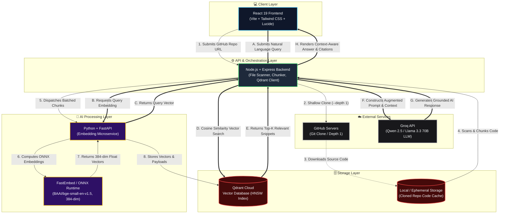

<div align="center">

# ⚡ SourceQuery

### AI-Powered Semantic Code Search Engine using RAG

Ask questions about any public GitHub repository in natural language and receive instant, context-aware answers with file-level citations powered by vector embeddings, Qdrant Cloud, and Groq LLMs.

<br>

[](https://source-query-swart.vercel.app)
[](https://sourcequery-api.onrender.com)
[](https://qdrant.tech/)
[](https://groq.com/)
[](LICENSE)

<br>

[](https://react.dev/)
[](https://vitejs.dev/)
[](https://tailwindcss.com/)
[](https://nodejs.org/)
[](https://fastapi.tiangolo.com/)
[](https://github.com/qdrant/fastembed)

</div>

---

## 🌐 Live Deployments

| Component | Service | Cloud Platform | Live Link |
| :--- | :--- | :--- | :--- |
| **Frontend Web App** | React 19 + Vite | Vercel Edge CDN | **[source-query-swart.vercel.app](https://source-query-swart.vercel.app)** |
| **Orchestration API** | Node.js + Express | Render Cloud | **[sourcequery-api.onrender.com](https://sourcequery-api.onrender.com)** |
| **Vector Embedding Service** | FastAPI + FastEmbed | Render Cloud | **[sourcequery-embedding.onrender.com](https://sourcequery-embedding.onrender.com)** |
| **Vector Database** | Qdrant Cloud | AWS Cloud Cluster | **[cloud.qdrant.io](https://cloud.qdrant.io)** |

---

## 🏛️ System Architecture

SourceQuery employs a decoupled **Retrieval-Augmented Generation (RAG)** architecture consisting of three primary layers: a modern React client, an Express.js orchestration backend, and a dedicated Python vector embedding microservice backed by Qdrant Vector Cloud and Groq high-speed LLMs.



---

## 🔄 Execution Workflows

### 🟠 1. Ingestion & Indexing Pipeline

```text
GitHub Repo URL ──▶ Git Clone ──▶ File Filter ──▶ Code Chunker ──▶ FastEmbed (ONNX) ──▶ Qdrant Cloud Upsert
```

1. **Repository Submission**: The user enters any public GitHub URL (e.g., `https://github.com/facebook/react`).
2. **Shallow Clone**: The Express backend executes a fast, single-depth clone (`git clone --depth 1`) to minimize network bandwidth.
3. **Smart File Scanning**: Ignores binaries, build outputs (`dist/`, `build/`, `node_modules/`), lock files (`package-lock.json`, `yarn.lock`), and focuses on code files (`.js`, `.jsx`, `.ts`, `.tsx`, `.py`, `.go`, `.rs`, `.cpp`, `.md`).
4. **Semantic Code Chunking**: Slices source files into semantic chunks around syntactic boundaries (`class`, `function`, `export`, `async`, `interface`) with overlapping context.
5. **Vector Embedding**: Sends chunks to the Python microservice running **`BAAI/bge-small-en-v1.5`** via ONNX Runtime to produce 384-dimensional dense vectors.
6. **Vector Upsert**: Embeddings, metadata (file names, relative paths, line numbers), and raw code snippets are stored in a dedicated Qdrant collection.

---

### 🔵 2. Query & Search Pipeline

```text
User Question ──▶ Vectorize Query ──▶ Qdrant Cosine Search ──▶ Score Boosting ──▶ Groq LLM Ingestion ──▶ Answer + Citations
```

1. **Question Vectorization**: The query string is converted into a 384-dimensional query vector via the embedding microservice.
2. **Cosine Similarity Search**: Qdrant executes approximate nearest neighbor (ANN) search using HNSW indexing to retrieve the top 20 candidate chunks.
3. **Smart Score Boosting**: Candidate snippets are re-ranked based on file importance:
   - `README.md` / `ARCHITECTURE.md` receives a `+0.08` boost for architectural questions.
   - Core `/src/` and `/docs/` paths receive a `+0.02 - +0.05` boost.
   - Config files and boilerplate receive negative scores.
4. **Context Injection & Prompt Engineering**: The top highest-ranking snippets are formatted with file paths and line ranges into an isolated system prompt.
5. **LLM Synthesis**: Groq's high-throughput Llama/Qwen engine synthesizes a concise, step-by-step technical explanation with verified file citations.

---

## ✨ Key Features

- **Natural Language Code Intelligence**: Ask questions like *"How does authentication work in this repo?"* or *"Where is the database connection configured?"*
- **Accurate File Citations**: Every answer highlights the exact files and relative paths referenced.
- **Smart Retrieval Boosting**: Automated heuristic re-ranking ensures high-level overview files and core logic take precedence over build configs.
- **Microsecond Vector Retrieval**: Powered by Qdrant's vector engine with HNSW indexing.
- **Ultra-Fast LLM Inference**: Powered by Groq Cloud for sub-second streaming answers.
- **Memory-Efficient Embeddings**: Custom Python microservice using FastEmbed (<80MB RAM footprint) running ONNX Runtime on shared cloud infrastructure.
- **Clean Responsive UI**: Modern dark-themed dashboard built with React 19, Tailwind CSS, and Lucide icons.

---

## 🛠️ Tech Stack

| Domain | Technology | Description |
| :--- | :--- | :--- |
| **Frontend** | React 19, Vite, Tailwind CSS | Client interface, responsive chat layout, and code markdown viewer |
| **Backend API** | Node.js, Express.js | Ingestion pipeline orchestration, Git cloning, chunking, and search routing |
| **Embeddings** | Python 3.11, FastAPI, FastEmbed | High-speed ONNX vectorization microservice (`BAAI/bge-small-en-v1.5`) |
| **Vector Database** | Qdrant Cloud | Managed vector database with cosine distance indexing |
| **LLM Inference** | Groq Cloud (Qwen / Llama 3.3) | High-speed token generation for context synthesis |
| **Hosting** | Vercel (Client) + Render (APIs) | Continuous deployment with automated Git integration |

---

## 📁 Repository Structure

```text
SourceQuery/
├── client/                      # React 19 + Vite Frontend
│   ├── public/                  # Static assets and icons
│   ├── src/
│   │   ├── components/          # SearchBar, RepoList, AnswerView, References
│   │   ├── pages/               # Home dashboard view
│   │   ├── services/            # Axios API client
│   │   ├── App.jsx              # Main React application
│   │   └── main.jsx             # React DOM entry point
│   ├── package.json
│   ├── vercel.json              # SPA rewrite routing config for Vercel
│   └── vite.config.js
│
├── server/                      # Node.js + Express Orchestration Backend
│   ├── config/                  # Qdrant client configuration & collection utils
│   ├── controllers/             # repository.controller.js, search.controller.js
│   ├── routes/                  # repository.routes.js, search.routes.js, health.routes.js
│   ├── services/                # github.service, fileScanner, chunker, gemini/groq
│   ├── utils/                   # collection.util.js
│   ├── server.js                # Express entry point (0.0.0.0 port binding)
│   ├── app.js                   # Middleware & route definitions
│   └── package.json
│
├── embedding-service/           # Python + FastAPI Vectorization Microservice
│   ├── app.py                   # FastAPI app with FastEmbed ONNX engine & ThreadPool
│   └── requirements.txt         # fastapi, uvicorn, fastembed
│
├── render.yaml                  # Infrastructure as Code (Render Cloud Blueprint)
└── README.md                    # Project Documentation
```

---

## 🚀 Local Development Setup

### 1. Prerequisites
- **Node.js** >= 20.x
- **Python** >= 3.10
- **Git**
- A free **[Qdrant Cloud](https://cloud.qdrant.io)** cluster and API key
- A free **[Groq Cloud](https://console.groq.com)** API key

---

### 2. Clone the Repository
```bash
git clone https://github.com/choudharysaransh54-alt/SourceQuery.git
cd SourceQuery
```

---

### 3. Start Embedding Microservice (Python)
```bash
cd embedding-service
python -m venv venv

# Windows
venv\Scripts\activate
# macOS/Linux
source venv/bin/activate

pip install -r requirements.txt
python app.py
```
*The embedding service will start on `http://localhost:8000`.*

---

### 4. Start Backend API (Node.js)
Open a new terminal:
```bash
cd server
npm install
```

Create a `.env` file inside `server/`:
```env
PORT=5000
GROQ_API_KEY=your_groq_api_key_here
QDRANT_URL=https://your-cluster-id.us-east-1-1.aws.cloud.qdrant.io:6333
QDRANT_API_KEY=your_qdrant_api_key_here
EMBEDDING_SERVICE_URL=http://localhost:8000
```

Start the backend:
```bash
npm run dev
```
*The server will start on `http://localhost:5000`.*

---

### 5. Start Frontend (React + Vite)
Open a third terminal:
```bash
cd client
npm install
npm run dev
```
*Open `http://localhost:5173` in your browser.*

---

## ⚙️ Environment Variables Reference

### Backend (`server/.env`)
| Variable | Required | Description |
| :--- | :---: | :--- |
| `PORT` | Optional | Port for Express server (Defaults to `5000` locally, `$PORT` on Render) |
| `GROQ_API_KEY` | **Yes** | API key from Groq Console for LLM inference |
| `QDRANT_URL` | **Yes** | HTTPS URL of your Qdrant cluster |
| `QDRANT_API_KEY` | **Yes** | Authentication API key for your Qdrant cluster |
| `EMBEDDING_SERVICE_URL` | **Yes** | URL pointing to the FastAPI embedding service |

### Frontend (`client/.env`)
| Variable | Required | Description |
| :--- | :---: | :--- |
| `VITE_API_URL` | **Yes** | Full URL of the backend API router (e.g. `https://sourcequery-api.onrender.com/api`) |

---

## 🛡️ License

Distributed under the **MIT License**. See [`LICENSE`](LICENSE) for more information.

---

## 👤 Author

**Saransh Choudhary**
- GitHub: [@choudharysaransh54-alt](https://github.com/choudharysaransh54-alt)
- Project Repository: [https://github.com/choudharysaransh54-alt/SourceQuery](https://github.com/choudharysaransh54-alt/SourceQuery)